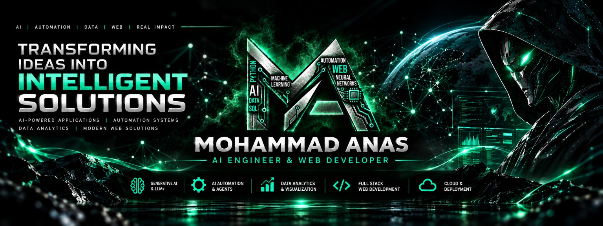

**AI & Machine Learning Engineer | Generative AI & Agentic Systems | Data Science & Engineering**

_Engineering intelligent systems — from data pipelines and machine learning models to autonomous AI agents and production-ready applications._

---

## 🧠 About Me

I am an **AI & Machine Learning Engineer** with a Master of Computer Applications (MCA) and a B.Sc. in Statistics and Mathematics. Combining my strong mathematical foundation with practical experience as a Data Analytics Intern at GeeksforGeeks, I engineer intelligent, scalable, and data-driven solutions.

My hands-on technical work spans **Generative AI applications, autonomous agents, multimodal AI systems, machine learning models, data pipelines, and Python-based APIs**. I specialize in building end-to-end applications using frameworks like LangGraph, LangChain, RAG architectures, and FastAPI, ultimately deploying reliable ML systems to the cloud.

I approach complex problems with an engineering mindset—focusing on robust architectures, reliable inference, and scalable deployments.

---

## 🎯 Engineering Specializations

- **AI & Machine Learning Engineering:** Designing, training, and deploying classical machine learning and deep learning models for practical environments.
- **Generative AI & Agentic Systems:** Architecting intelligent autonomous agents, implementing complex RAG pipelines, and orchestrating multi-agent workflows using LangGraph and CrewAI.
- **End-to-End AI Applications:** Building user-facing, multimodal applications with FastAPI, Streamlit, and modern cloud deployment platforms.
- **Data Science & Data Engineering:** Developing robust ETL workflows, conducting exploratory data analysis, and building predictive analytics solutions.

---

## 💻 Featured AI/ML Projects

### [AI Researcher — Autonomous Literature Review Agent](https://github.com/Anas262/AI-Researcher)

- **Problem:** Researchers spend excessive time discovering, filtering, and synthesizing complex academic papers.
- **Solution:** An autonomous agent that automates paper discovery, PDF analysis, and literature synthesis.
- **Core Architecture:** Agentic workflow leveraging LangGraph for state management and reasoning, integrating arXiv for dynamic retrieval.
- **Tech Stack:** Python, LangGraph, LangChain, Gemini, arXiv API, Streamlit.
- **Highlights:** Complex tool orchestration, persistent memory handling, and real-time structured report generation.
- **Links:** [Source Code](https://github.com/Anas262/AI-Researcher)

### [AI Skin Specialist — Multimodal AI Application](https://github.com/Anas262?tab=repositories&q=skin)

- **Problem:** Users need accessible, preliminary informational analysis of skin conditions using text, voice, and images.
- **Solution:** A multimodal AI application that processes diverse inputs to provide informational insights _(Note: Informational purposes only; not a clinical diagnostic system)_.
- **Core Architecture:** FastAPI backend integrating specialized models (vision, transcription, inference) via asynchronous API calls.
- **Tech Stack:** FastAPI, Groq, Whisper, Qwen Vision, Deepgram.
- **Highlights:** Multimodal inference pipelines, asynchronous Python, and real-time API orchestration.
- **Links:** [Source Code](https://github.com/Anas262?tab=repositories&q=skin)

### [Diamond Price Prediction](https://github.com/Anas262/Diamond-Price-Prediction-)

- **Problem:** Inconsistent diamond pricing requiring objective, data-driven valuation models.
- **Solution:** An end-to-end regression system with a web-based interface for real-time price inference.
- **Core Architecture:** Scikit-learn predictive model integrated into a Flask backend, supported by a data preprocessing pipeline.
- **Tech Stack:** Scikit-learn, Pandas, Flask, Render.
- **Highlights:** Complete ML lifecycle—from EDA and feature engineering to model serving and cloud deployment.
- **Links:** [Source Code](https://github.com/Anas262/Diamond-Price-Prediction-)

### [Wafer Fault Detection](https://github.com/Anas262/WAFER_FAULT_DETECTION)

- **Problem:** High defect rates in semiconductor manufacturing requiring automated fault prediction.
- **Solution:** A robust machine learning model to predict industrial faults based on complex sensor data.
- **Tech Stack:** Python, Scikit-learn, Pandas, Machine Learning.
- **Highlights:** Handling high-dimensional industrial datasets and implementing effective classification algorithms.
- **Links:** [Source Code](https://github.com/Anas262/WAFER_FAULT_DETECTION)

### [Movie Recommender System](https://github.com/Anas262/Movie-Recommender-System)

- **Problem:** Information overload preventing users from finding relevant films.
- **Solution:** A personalized recommendation engine utilizing similarity metrics and feature extraction.
- **Tech Stack:** Python, Recommender Systems.
- **Highlights:** Implementation of vector similarities and robust feature extraction pipelines.
- **Links:** [Source Code](https://github.com/Anas262/Movie-Recommender-System)

### [Laptop Price Predictor](https://github.com/Anas262/Laptop_Price_predictor)

- **Problem:** Predicting dynamic laptop prices based on varying hardware specifications.
- **Solution:** A regression-based machine learning pipeline predicting market prices.
- **Tech Stack:** Python, Machine Learning.
- **Highlights:** Feature encoding, data transformations, and predictive modeling on hardware specification datasets.
- **Links:** [Source Code](https://github.com/Anas262/Laptop_Price_predictor)

---

## ⚡ AI Engineering & Technology Stack

**The Technologies, Frameworks & Tools Behind My Intelligent Solutions**

 

### 01 — Core Engineering & Languages

<table>
  <tr>
    <td align="center" width="90">
       Python
    </td>
    <td align="center" width="90">
       JavaScript
    </td>
    <td align="center" width="90">
       TypeScript
    </td>
    <td align="center" width="90">
       HTML5
    </td>
    <td align="center" width="90">
       CSS3
    </td>
    <td align="center" width="90">
       SQL
    </td>
  </tr>
</table>

### 02 — Generative AI & Agentic Systems

<table>
  <tr>
    <td align="center" width="90">
       LangChain
    </td>
    <td align="center" width="90">
       LangGraph
    </td>
    <td align="center" width="90">
       OpenAI
    </td>
    <td align="center" width="90">
       Claude
    </td>
    <td align="center" width="90">
       Hugging Face
    </td>
    <td align="center" width="90">
       Gemini
    </td>
  </tr>
  <tr>
    <td align="center" width="90">
       CrewAI
    </td>
    <td align="center" width="90">
       LlamaIndex
    </td>
  </tr>
</table>

### 03 — Machine Learning & Deep Learning

<table>
  <tr>
    <td align="center" width="90">
       PyTorch
    </td>
    <td align="center" width="90">
       TensorFlow
    </td>
    <td align="center" width="90">
       Scikit-Learn
    </td>
    <td align="center" width="90">
       Keras
    </td>
    <td align="center" width="90">
       SciPy
    </td>
    <td align="center" width="90">
       OpenCV
    </td>
  </tr>
</table>

### 04 — Data Science & Analytics

<table>
  <tr>
    <td align="center" width="90">
       Excel
    </td>
    <td align="center" width="90">
       Power BI
    </td>
    <td align="center" width="90">
       Tableau
    </td>
    <td align="center" width="90">
       Pandas
    </td>
    <td align="center" width="90">
       NumPy
    </td>
    <td align="center" width="90">
       Plotly
    </td>
  </tr>
</table>

### 05 — Data Engineering & Databases

<table>
  <tr>
    <td align="center" width="90">
       PostgreSQL
    </td>
    <td align="center" width="90">
       MySQL
    </td>
    <td align="center" width="90">
       MongoDB
    </td>
    <td align="center" width="90">
       Apache Spark
    </td>
    <td align="center" width="90">
       Airflow
    </td>
    <td align="center" width="90">
       dbt
    </td>
  </tr>
</table>

### 06 — Backend & Full-Stack Development

<table>
  <tr>
    <td align="center" width="90">
       FastAPI
    </td>
    <td align="center" width="90">
       Django
    </td>
    <td align="center" width="90">
       Flask
    </td>
    <td align="center" width="90">
       Streamlit
    </td>
    <td align="center" width="90">
       React
    </td>
    <td align="center" width="90">
       Next.js
    </td>
  </tr>
</table>

### 07 — Cloud, DevOps & Deployment

<table>
  <tr>
    <td align="center" width="90">
       Docker
    </td>
    <td align="center" width="90">
       Linux
    </td>
    <td align="center" width="90">
       AWS
    </td>
    <td align="center" width="90">
       Azure
    </td>
    <td align="center" width="90">
       Git
    </td>
    <td align="center" width="90">
       GitHub
    </td>
  </tr>
  <tr>
    <td align="center" width="90">
       Render
    </td>
    <td align="center" width="90">
       Vercel
    </td>
    <td align="center" width="90">
       Heroku
    </td>
    <td align="center" width="90">
       MLflow
    </td>
    <td align="center" width="90">
       Vector DBs
    </td>
    <td align="center" width="90">
       CI/CD
    </td>
  </tr>
</table>

---

## 💼 Experience

**Data Analytics Intern** | GeeksforGeeks  
_August 2024 – January 2025_

- Engineered Python, Pandas, and NumPy workflows for comprehensive ETL, data cleaning, and transformation processes.
- Developed interactive KPI dashboards and analytical reporting workflows to support data-driven decision-making.
- Applied exploratory data analysis (EDA), feature analysis, and statistical problem-solving techniques to complex structured datasets.

---

## 📚 Currently Exploring

_(Advanced AI engineering concepts and tools I am actively mastering.)_

<table>
  <tr>
    <td align="center" width="90">
       RAGAS
    </td>
    <td align="center" width="90">
       Supabase
    </td>
    <td align="center" width="90">
       LangSmith
    </td>
    <td align="center" width="90">
       PEFT
    </td>
    <td align="center" width="90">
       Graph RAG
    </td>
    <td align="center" width="90">
       LoRA
    </td>
  </tr>
</table>

---

## 🎓 Education & Certifications

**Education**

- **Master of Computer Applications (MCA)** — Khwaja Moinuddin Chishti Language University (2024)
- **B.Sc. Statistics & Mathematics** — Shia P.G. College (2021)

**Verified Certifications**

- Data Analytics Job Simulation — Deloitte Australia (2026)
- Prompt Engineering — CampusX (2026)
- NLP in Python; Prompt & Context Engineering 101 — Udemy (2026)
- Data Analytics Certification — GeeksforGeeks (2025)
- Data Science Masters — PW Skills (2024)

---

## 📊 GitHub Statistics

  
  

> _Note: GitHub statistics are provided by a third-party service and may be temporarily unavailable._

---

## 🌐 Portfolio Website — In Development

🚧 **Status: In Active Development** 🚧

I am currently engineering a comprehensive personal portfolio website to showcase my professional journey. The platform will feature deep technical case studies, live AI/ML project demos, interactive Generative AI applications, data science analytics, and specialized freelance service offerings.

_(The public URL will be updated here upon deployment.)_

---

## 📩 Contact & Collaboration

**Engineering intelligent systems — from data to deployment.**

